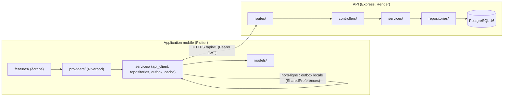
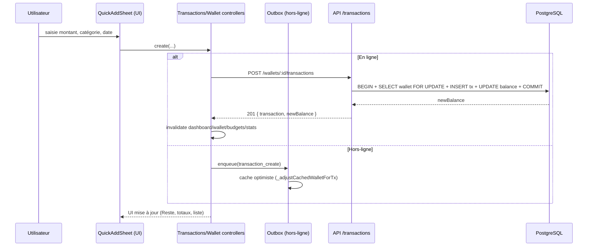

# Architecture technique de MyBudget

## Sommaire

- [Résumé](#résumé)
- [Vue d'ensemble (diagramme)](#vue-densemble-diagramme)
- [Mobile : couches](#mobile--couches)
- [State management : Riverpod](#state-management--riverpod)
- [Navigation : go_router](#navigation--go_router)
- [Backend : couches](#backend--couches)
- [Flux - ajouter une dépense](#flux---ajouter-une-dépense)
- [Services et dépendances (mobile)](#services-et-dépendances-mobile)
- [Ce qui n'existe PAS](#ce-qui-nexiste-pas)

## Résumé

MyBudget est une app Flutter (Android) + API Express/PostgreSQL. Le mobile s'organise en `features/` (écrans), `providers/` (Riverpod), `services/` (réseau et cache), `models/` ; le backend en routes → contrôleurs → services → repositories. **Ni Firebase ni Firestore ne sont utilisés** : l'auth est un JWT maison, la base est PostgreSQL 16 (docker-compose en local, Neon en production sur Render).

## Vue d'ensemble (diagramme)



*Exports PNG/SVG : `docs/diagrams/architecture-globale.png|svg` (générés par `docs/build.ps1`).*

## Mobile : couches

| Couche | Dossier | Rôle |
|---|---|---|
| Présentation | `lib/features/**` (auth, home, history, stats, budgets, savings, reset, profile, help, categories, shell, onboarding) | Écrans Material 3, thème clair/sombre (`AppTheme`), texte français simple |
| État / application | `lib/providers/**` (Riverpod v3) | `AuthController`, `WalletController`, `TransactionsController`, `DashboardController`, `StatsController`, `BudgetsController`, `SyncController`, `CategoryController`, `OnboardingSeenNotifier`, `ThemeController`, `AlertsController`, `ShellTabController` |
| Données | `lib/services/**` | `ApiClient` (Dio, intercepteurs auth/retry), `TransactionRepository`/`DataRepository`/`WalletRepository`, `CategoryRepository`, `BudgetAlertsService` (notifications locales), `Outbox` (file d'attente), `CacheService` (SharedPreferences), `TokenStorage`, `ErrorReporter` |
| Modèles | `lib/models/**` | `Wallet`, `Transaction`, `User`, `AuthSession`, `DashboardData`, `StatsData`, `Budget`, `BudgetPeriod`… Montants entiers FCFA |
| Transverse | `lib/core/**` | Thème, `date_format.dart` (JJ/MM/AAAA local), `money.dart` (`formatXof`), `search/` (recherche insensible accents), widgets partagés |
| Navigation | `lib/routing/**` | `app_router.dart` (GoRouter + `refreshListenable`), `app_redirect.dart` (fonction pure de redirection) |

L'architecture n'applique **pas** à la lettre le trio data/domain/presentation : les modèles vivent dans `models/` et la logique de données dans `services/` ; c'est volontaire et cohérent pour la taille du projet.

## State management : Riverpod

- Riverpod v3 (`flutter_riverpod`), `AsyncNotifier` pour les données distantes (`AuthController`, `WalletController`, …), `Notifier` pour les états de session locaux (`SyncController`, `OnboardingSeenNotifier`).
- Stratégie « cache d'abord, revalidation en arrière-plan » pour portefeuille, tableau de bord et budgets : l'écran affiche immédiatement les dernières données réelles, puis se met à jour dès que le réseau répond.
- Les erreurs réseau/timeout ne sont **jamais** présentées comme « Hors ligne » : timeout = silencieux, erreur métier = message français (`messageFrom` sur chaque contrôleur).

## Navigation : go_router

- Un seul `GoRouter` (`routerProvider`), jamais recréé : `refreshListenable: _RouterTransitionNotifier` écoute auth + onboarding.
- Redirection centralisée et **pure** dans `app_redirect.dart` (testée unitairement) : onboarding non vu → `/onboarding` ; vu → jamais ré-affiché ; restauration de session → `/splash` ; connecté sur écrans d'auth → `/home` ; non connecté → `/login`.
- Routes : `/onboarding`, `/splash`, `/login`, `/register`, `/forgot-password`, `/wallet-setup`, `/home` (shell, 4 onglets), `/savings`, `/stats`, `/help` (Aide et FAQ).

## Backend : couches

```
routes/        définition des endpoints + authenticate (JWT) / verifyIdToken (legacy Ciel)
controllers/   orchestration des requêtes/réponses (savings, transactions, wallet, auth)
services/      règles métier et transactions SQL (transactionService, savingsService,
               periodService, statsService, goalService, walletService, authService)
repositories/  accès SQL (pool pg, FOR UPDATE pour la concurrence)
validators/    validation des entrées (manuel + zod pour les endpoints Ciel)
config/        env.js (variables), db.js (Pool + withTransaction)
middlewares/   authenticate, requestLogger (JSON), errorHandler (5xx masqués en prod), verifyIdToken
database/      migrate.js + migrations 001→009 (004 absent)
```

- Toutes les requêtes protégées passent par `authenticate` (JWT access 1 h). Le principal `user_id` vient du token, jamais du corps de la requête.
- Écritures concurrentes : `SELECT ... FOR UPDATE` sur la ligne `wallets` dans une transaction SQL (`withTransaction`), rollback automatique.
- Rate limiting global 120 req/min/IP (`RATE_LIMIT_WINDOW_MS`/`RATE_LIMIT_MAX`), renforcé sur `/auth/*` (30 req / 15 min) et `/client-errors` (20 / min).
- Réponses normalisées : `{ success, data | error: { code, message } }`.

## Flux - ajouter une dépense



Points clés : montant entier ; refus côté serveur si `amount > balance − savings_amount` (409 `BALANCE_INSUFFICIENT`) ; rollback optimiste si la réponse est une erreur métier 4xx au moment du flush.

## Services et dépendances (mobile)

Dépendances de production : `flutter_riverpod`, `go_router`, `dio`, `intl`, `flutter_dotenv`, `shared_preferences`, `connectivity_plus`, `uuid`, `fl_chart`, `path_provider`, `share_plus`, `pdf`, `package_info_plus`, `flutter_localizations`. Aucune dépendance Firebase.

## Ce qui n'existe PAS

- Firebase (Auth, Firestore, FCM, Crashlytics) — abandonné en novembre 2026. Voir `docs/PHASE1_ARCHITECTURE.md`.
- Détection automatique des transactions par notifications Android (lecture des notifs Mobile Money) — non implémentée (voir `docs/detection-notifications.md`).
- Les alertes de budget sont des **notifications locales** (jamais d'envoi serveur), une seule fois par seuil (80 % / 100 %) et par période ; l'interrupteur « Alertes de budget » du profil les coupe ou les demande (permission Android 13 `POST_NOTIFICATIONS`).
- Routes Ciel (`/stats/monthly`, `/export/*`, `/alerts/check`) : héritage d'un client « ciel.app ». Les requêtes SQL internes référencent des colonnes inexistantes et renvoient silencieusement des résultats vides ; `firebase-admin` n'étant pas installé, `verifyIdToken` retombe sur un fallback JWT/test. **À considérer comme obsolètes.**
- `web/` et `ios/` existent (scaffolds) mais ne sont pas maintenus ni testés.

## À confirmer

- ~~Build AAB (Play Store)~~ **Vérifié le 17/11/2026** : `flutter build appbundle --release --flavor play` produit un `.aab` (~53 Mo).
