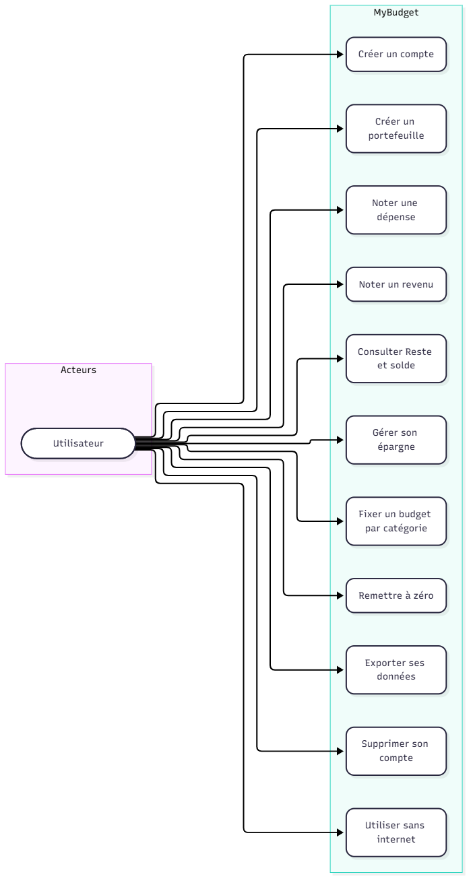
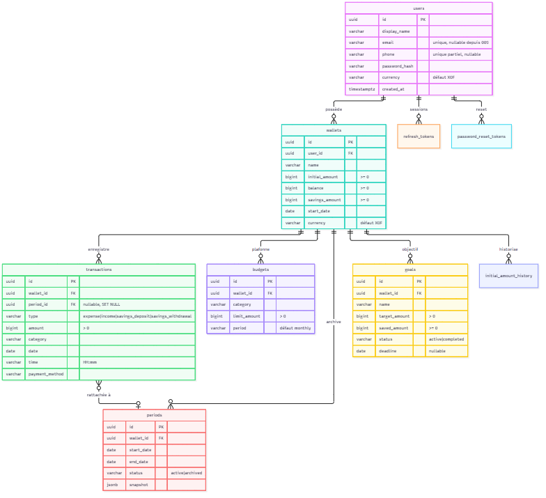
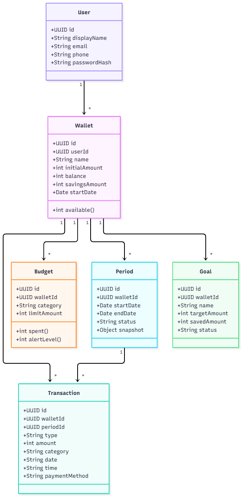
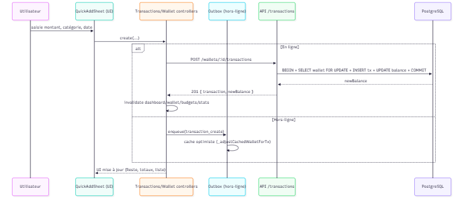
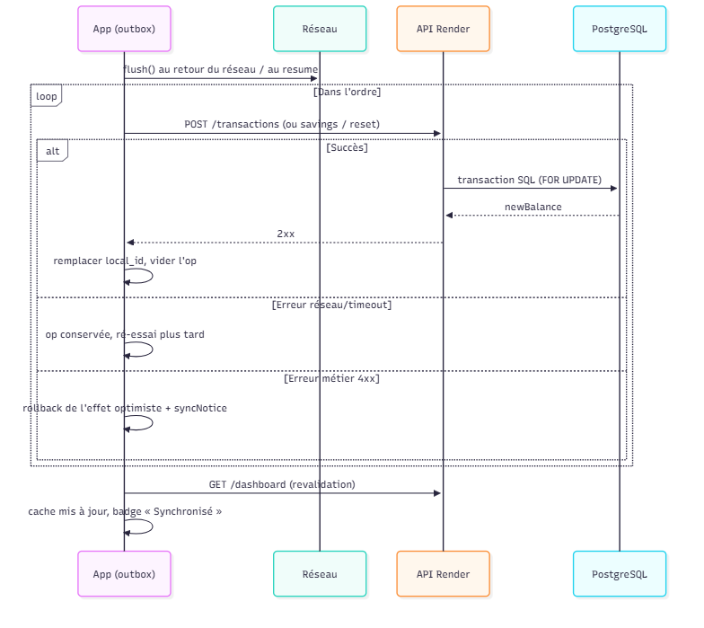
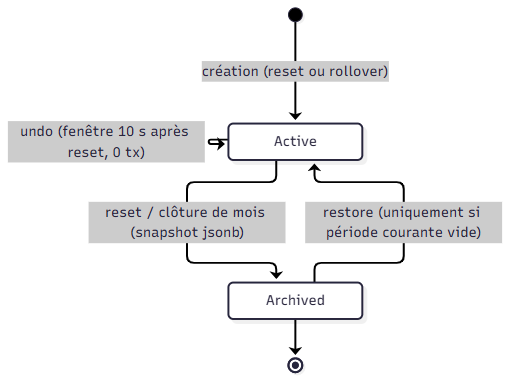
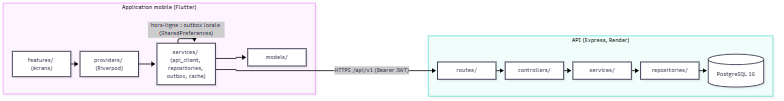

# Dossier de conception — MYBUDGET

*Gestion de budget personnel en XOF/FCFA (multi-devise à l'affichage) — mobile (Flutter) + API (Node.js/PostgreSQL)*

**Résumé en 3 lignes :** MyBudget répond au besoin de noter ses dépenses et revenus en quelques secondes, comprendre où part son argent et garder une épargne à portée de main — même sans réseau. Le système est une app mobile Flutter connectée à une API Express/PostgreSQL auto-hébergée sur Render. Ce dossier présente le contexte, le besoin, les modèles (cas d'utilisation, MCD/MLD, classes, séquences), l'architecture, la sécurité, les tests, les limites et les perspectives.

**Maquettes UI :** https://claude.ai/artifact/HB3BtGzUmHKbVmGCxYVCHC (maquette « MyBudget » en ligne) ainsi que `docs/maquette/` (artefacts historiques, non reliés au code).

## Sommaire

- [Contexte et problème](#contexte-et-problème)
- [Objectifs](#objectifs)
- [Besoins fonctionnels](#besoins-fonctionnels)
- [Besoins non fonctionnels](#besoins-non-fonctionnels)
- [Acteurs](#acteurs)
- [Cas d'utilisation (UML)](#cas-dutilisation-uml)
- [MCD — Merise (entités-associations)](#mcd--merise-entités-associations)
- [MLD](#mld)
- [Diagramme de classes](#diagramme-de-classes)
- [Diagrammes de séquence](#diagrammes-de-séquence)
- [Architecture technique](#architecture-technique)
- [Sécurité](#sécurité)
- [Tests](#tests)
- [Limites et perspectives](#limites-et-perspectives)
- [Glossaire](#glossaire)

## Page de garde

| Champ | Valeur |
|---|---|
| Nom du projet | MYBUDGET |
| Version du document | 1.0 (17/11/2026) |
| Équipe | [À REMPLIR] |
| École / organisme | [À REMPLIR] |
| Encadrant | [À REMPLIR] |
| Contact | [À REMPLIR] |

## Contexte et problème

Dans la vie quotidienne, l'argent sort vite : transports, restauration, transferts Mobile Money, abonnements… La plupart des gens n'ont pas de vision consolidée ni mensuelle de leurs dépenses. Les solutions du marché sont soit trop complexes, soit inadaptées au contexte francophone d'Afrique de l'Ouest (FCFA entiers, connexion instable, téléphone Android d'entrée de gamme).

**Problème posé :** comment aider une personne à savoir, à tout moment et en 3 taps, ce qui lui reste réellement à dépenser, combien elle a mis de côté, et si elle tient son budget du mois — y compris sans Internet ?

**Réponse de MyBudget :** noter ses opérations en 10 secondes, afficher un « Reste » (solde moins épargne), surveiller ses budgets (alertes 50/80/100 %), fonctionner hors-ligne avec synchronisation automatique.

## Objectifs

1. Noter dépense ou revenu en moins de 10 secondes, même hors connexion.
2. Afficher un solde exact et un « Reste » toujours juste (épargne déduite).
3. Gérer une épargne intégrée (versement, retrait, tout récupérer) sans compte supplémentaire.
4. Fixer des budgets par catégorie avec alertes visuelles (50/80/100 %).
5. Historiser les périodes mensuelles (archivage + annulation 10 s).
6. Garantir la confidentialité (aucune donnée vendue ; suppression possible).

## Besoins fonctionnels

| # | Fonction | Description | Priorité |
|---|---|---|---|
| F1 | Compte utilisateur | Inscription/connexion par téléphone + mot de passe ; reset de mot de passe | Must |
| F2 | Portefeuille | Création, montant initial historisable | Must |
| F3 | Opérations | Dépense/revenu : montant entier (stocké en XOF), catégorie, date, mode de paiement, note ; affichage/saisie en devise active (XOF/EUR/USD) | Must |
| F4 | Reste et solde | Solde recalculé côté serveur, atomique ; Reste = solde − épargne | Must |
| F5 | Épargne | Versement, retrait, tout récupérer ; exclue des dépenses et stats | Must |
| F6 | Budgets | Par catégorie, montant mensuel, alertes 50/80/100 % | Must |
| F7 | Périodes mensuelles | Archivage en fin de mois, remise à zéro, annulation 10 s, restauration | Must |
| F8 | Recherche | Recherche plein-historique (montants, dates, types, accents ignorés) | Should |
| F9 | Statistiques | Semaine/mois/année, comparaison N−1, moyenne/jour, répartition par catégorie | Should |
| F10 | Statistiques | Hebdomadaire, mensuelle, annuelle | Should |
| F11 | Objectifs d'épargne | Cibles, contributions, échéance, statut | Could |
| F12 | Export | PDF (app, `operations_AAAA-MM-JJ.pdf`, devise active) / CSV (API) | Could |
| F13 | Aide et FAQ | 15 questions en accordéon, hors-ligne | Should |
| F14 | Hors-ligne | File d'attente + synchronisation au retour (id client UUID, fusion catégories) | Must |
| F15 | Catégories personnalisées | Création via « Autres » (nom obligatoire, 2–30 caractères, première lettre en majuscule), renommage, suppression (réaffectation à « Autres »), 30 max par type, hors-ligne | Should |
| F16 | Supprimer tout | Compte « comme neuf » (atomique, `data_epoch`, multi-appareils) ; Zone de danger, PDF optionnel avant, confirmation forte | Must |
| F18 | Devises | XOF (défaut, entiers), EUR (parité fixe 655,957), USD (taux variable, cache + secours, date affichée) ; conversion à l'affichage/saisie uniquement | Must |
| F17 | Alertes de budget réelles | Notification locale à 80 %/100 %, une fois par seuil et période | Should |

## Besoins non fonctionnels

| # | Besoin | Cible |
|---|---|---|
| N1 | Performance | Solde affiché immédiatement (cache) ; sync < 2 s en 4G |
| N2 | Fiabilité | Écritures atomiques (transactions SQL + verrous) |
| N3 | Disponibilité | Render plan gratuit : réveil < 60 s géré par le client |
| N4 | Sécurité | bcrypt, JWT rotation, rate limiting, HTTPS, isolation par user_id |
| N5 | Sobriété | APK ~20 Mo (arm64), faible consommation de données |
| N6 | Accessibilité | FR simple, thème clair/sombre, Material 3, aucun jargon |
| N7 | Conformité (à discuter) | Pas de stockage de logs publicitaires ; voir `docs/politique-confidentialite.md` |

## Acteurs

- **Utilisateur** : personne qui gère ses finances personnelles.
- **Système MyBudget** : app mobile + API + base PostgreSQL.
- **Exploitant** : personne qui déploie (push sur `main`, logs Render/Neon). [À REMPLIR]

## Cas d'utilisation (UML)



Acteur principal : **Utilisateur**. Les cas UC1→UC11 couvrent tout le cycle d'usage, de l'inscription à la suppression de compte.

## MCD — Merise (entités-associations)



**Entités** : `users`, `wallets`, `transactions`, `budgets`, `periods`, `goals`, `categories`, `initial_amount_history`, `refresh_tokens`, `password_reset_tokens`.

**Associations** :

- `UTILISATEUR possède WALLET` (1,n) — un wallet appartient à un seul utilisateur.
- `UTILISATEUR personnalise CATEGORIE` (0,n) — `is_default=false` ; les défauts sont systèmes (user_id NULL).
- `WALLET enregistre TRANSACTION` (1,n) — une transaction appartient à un wallet et (optionnellement) à une période.
- `TRANSACTION classe CATEGORIE` (1,1) — via `category_id` (nullable avant migration).
- `WALLET plafonne BUDGET` (1,n) — un budget par (wallet, catégorie).
- `WALLET archive PERIOD` (1,n) — une seule période active ; les précédentes sont archivées avec snapshot JSON.
- `WALLET vise GOAL` (1,n) — les objectifs partagent le pot d'épargne du wallet.

## MLD

Héritage : toutes les tables portent `id UUID PK`, `created_at`/`updated_at` sauf `refresh_tokens`/`password_reset_tokens` (vue tokens) et `initial_amount_history` (journal).

```
users(id, display_name, email, phone, password_hash, photo_url, currency, data_epoch, created_at, updated_at)
refresh_tokens(id, user_id→users, token_hash, expires_at, revoked_at, created_at)
password_reset_tokens(id, user_id→users, token_hash, expires_at, used_at, created_at)
wallets(id, user_id→users, name, initial_amount, balance, savings_amount, start_date, currency, created_at, updated_at)
initial_amount_history(id, wallet_id→wallets, old_value, new_value, changed_at)
transactions(id, wallet_id→wallets, period_id→periods, type, amount, category, category_id→categories, description, date, time, payment_method, created_at, updated_at)
budgets(id, user_id→users, wallet_id→wallets, category, category_id→categories, limit_amount, period, UNIQUE(wallet_id, category), created_at, updated_at)
periods(id, user_id→users, wallet_id→wallets, start_date, end_date, status, snapshot JSONB, created_at, closed_at)
goals(id, user_id→users, wallet_id→wallets, name, target_amount, saved_amount, deadline, status, created_at, updated_at)
categories(id, user_id→users NULL, type, name, normalized_name, is_default, icon_key, created_at)
```

## Diagramme de classes

Les entités côté app (Dart) et côté API (JS/SQL) suivent le même vocabulaire. Cœur métier :



Règle clé : `Wallet.available() = max(0, balance − savingsAmount)`. Les six types supportés côté SQL (`expense`, `income`, `savings_deposit`, `savings_withdrawal`) sont reflétés par `models/transaction.dart`.

## Diagrammes de séquence

### Ajouter une dépense (nominal)



### Synchronisation hors-ligne



### Cycle d'une période mensuelle



## Architecture technique



- **Mobile** : Flutter 3 / Dart 3.12, Riverpod v3, go_router (1 router persistant), Dio (intercepteurs retry/auth), flutter_dotenv, SharedPreferences (cache + outbox), pdf + share_plus (exports).
- **API** : Node 20+, Express 5, PostgreSQL (`pg`), JWT maison (access 1 h / refresh 30 j hashé SHA-256, rotation), bcryptjs, zod + validation manuelle, express-rate-limit, helmet, morgan + logger JSON.
- **Hébergement** : Docker sur Render (free), Neon PostgreSQL (`sslmode=require`), migrations au démarrage.
- **CI** : GitHub Actions — build de l'APK arm64 release + publication sur release `latest`.
- **Hors périmètre** : Firebase/FCM (abandonné), détection de notifications (non implémentée, voir `docs/detection-notifications.md`).

## Sécurité

- Mots de passe bcrypt ; jetons de session hashés SHA-256 ; révocation globale sur changement.
- Toutes les requêtes SQL paramétrées (`pg`) ; verrous `FOR UPDATE` pour la concurrence.
- Isolation stricte par `user_id` (issu du JWT) ; aucune donnée n'est servie à un tiers.
- En-têtes `helmet`, rate limiting (120/min/IP global, 30/15 min sur `/auth/*`), CORS configurable.
- 5xx masqués côté client (« Erreur interne du serveur ») ; logs complets côté serveur avec `requestId`.
- Détails : `docs/securite-et-confidentialite.md` et `docs/politique-confidentialite.md`.

## Tests

- **Mobile** : 82 tests passent (`flutter test`) : redirections (`app_redirect`), onboarding, overflow 360×640, outbox (rollback 4xx, conservation réseau, catégories hors-ligne), recherche, PDF, FAQ, réinitialisation (écran), alertes de budget (7 tests), noms de catégories (8 tests).
- **Backend** : 9 unitaires + 10 e2e (`pg-mem`, vrai `app.js` en mémoire) + 1 test d'atomicité sur vraie PostgreSQL (`npm run test:rollback`) + 1 batterie « serveur réel » skippée par défaut (`npm run test:integration`).
- **Recette manuelle** : `docs/TESTS_HORS_LIGNE.md` + section « Recette manuelle » de `docs/tests.md`.

## Limites et perspectives

**Limites connues :**

1. Pas de détection automatique des transactions (Mobile Money) — saisie manuelle uniquement.
2. Alertes de budget uniquement locales (notification système) ; pas de notification push serveur.
3. Plan gratuit Render : mise en veille ~15 min, cold start 30–60 s.
4. Les routes périodes (`/wallets/:id/period*`, undo 10 s, restauration) existent sur l'API mais l'app n'appelle plus que la réinitialisation complète — l'annulation 10 s n'est plus exposée dans l'UI.
5. Routes « Ciel » obsolètes montées sur `/` et `/api/v1` — à désactiver.
6. iOS/web non maintenus ; APK uniquement (arm64).
7. Pas de synchronisation multi-appareil temps réel ; la dernière écriture serveur gagne.
8. Catégories : maximum 30 personnalisées par type ; renommage limité aux personnalisées.

**Perspectives :**

1. ACL Play Store : remplir le formulaire de sécurité des données + publier l'AAB signé.
2. Restauration de session PN automatique + réveil silencieux déjà en place (à capitaliser).
3. Détection de transactions sur le terminal (étude de faisabilité) — voir `docs/detection-notifications.md`.
4. Alertes push via un canal standard Android (capacités `POST_NOTIFICATIONS`), sans lecture des notifications.
5. Plan payant Render ou migration Neon→instance dédiée en cas de montée en charge.
6. Externalisation des crash reports vers Sentry/Logtail (le hook `ErrorReporter` est prêt).

## Glossaire

| Terme | Définition |
|---|---|
| XOF / FCFA | Franc de la zone franc (XOF), unité de référence de l'app ; entiers uniquement à la saisie FCFA |
| EUR | Euro — affichage/saisie, parité fixe officielle (1 EUR = 655,957 XOF) |
| USD | Dollar américain (affichage/saisie, taux variable, EUR/USD convertis à l'affichage) |
| Reste | Montant dépensable : `balance − savings_amount` (jamais négatif) |
| Épargne | Réserve interne au portefeuille (`savings_amount`), hors dépenses/stats |
| Période | Mois calendaire suivi ; remise à zéro = clôture + archive + nouvelle période |
| Outbox | File d'attente locale des écritures, rejouée au retour du réseau |
| Optimiste | L'UI applique l'effet avant confirmation ; rollback si 4xx |
| Cold start | Démarrage à froid du service Render après veille |
| JWT | Jeton signé (access 1 h, refresh 30 j hashé) authentifiant les appels API |
| MCD / MLD | Modèle conceptuel / logique de données (méthode Merise) |
| Snapshot | État sérialisé (JSONB) d'une période au moment de sa clôture |
| data_epoch | Compteur serveur (users.data_epoch) incrémenté à chaque réinitialisation ; signal multi-appareils d'effacement de cache |
| category_id | Lien vers la catégorie (défaut système ou personnalisée utilisateur) |
| pg-mem | Émulateur PostgreSQL en mémoire utilisé par les tests e2e |
