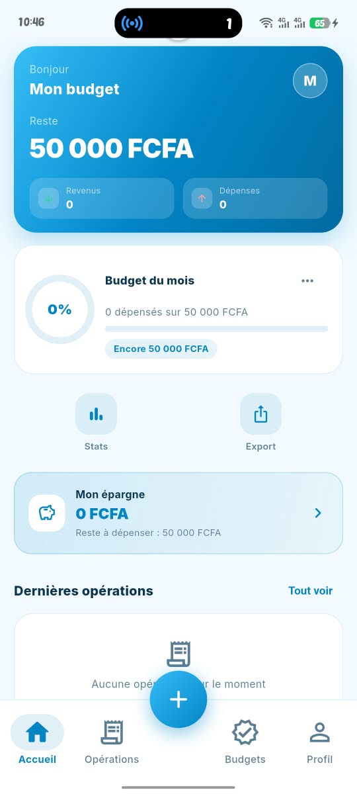
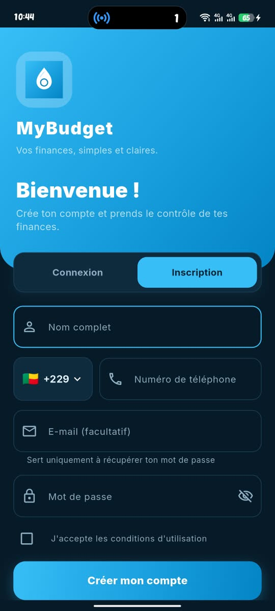
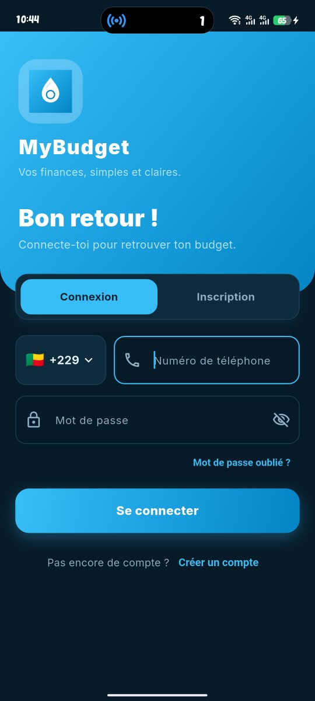
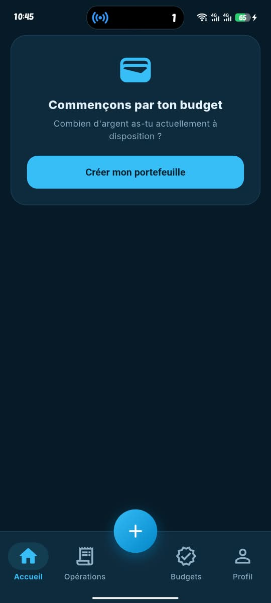
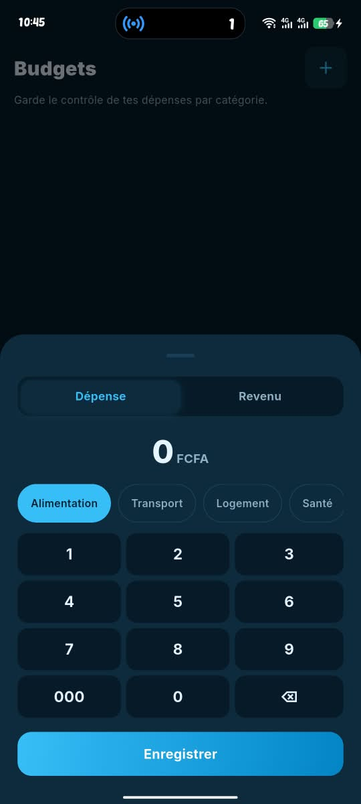
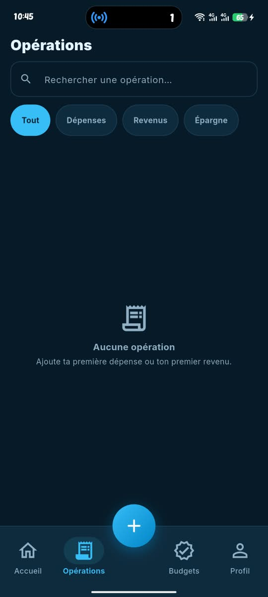
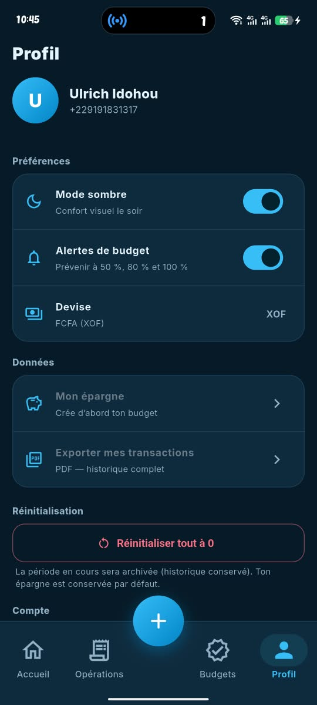

# Guide utilisateur — MYBUDGET

**Résumé en 3 lignes :** MyBudget t'aide à suivre ton argent (dépenses, revenus, épargne) et à tenir ton budget du mois, même sans réseau. Ce guide te montre l'essentiel : créer ton compte, noter une opération, comprendre ton « Reste », épargner, choisir ta devise, réinitialiser et supprimer ton compte. Aucune connaissance technique nécessaire.

## Sommaire

1. [Bienvenue](#1-bienvenue)
2. [Créer ton compte](#2-créer-ton-compte)
3. [Créer ton portefeuille](#3-créer-ton-portefeuille)
4. [Noter une dépense](#4-noter-une-dépense)
5. [Noter un revenu](#5-noter-un-revenu)
6. [Ton écran d'accueil et ton Reste](#6-ton-écran-daccueil-et-ton-reste)
7. [Tes budgets par catégorie](#7-tes-budgets-par-catégorie)
8. [Ton épargne](#8-ton-épargne)
9. [Retrouver une opération (recherche)](#9-retrouver-une-opération-recherche)
10. [Mes catégories](#10-mes-catégories)
11. [Ta devise (FCFA, €, $)](#11-ta-devise-fcfa--)
12. [Supprimer tout (Zone de danger)](#12-supprimer-tout-zone-de-danger)
13. [Sans internet](#13-sans-internet)
14. [Ta sécurité](#14-ta-sécurité)
15. [Supprimer ton compte](#15-supprimer-ton-compte)
16. [Aide et FAQ dans l'app](#16-aide-et-faq-dans-lapp)

---

## 1. Bienvenue

MyBudget est une app gratuite pour garder la main sur ton argent. Tu y notes ce que tu gagnes et ce que tu dépenses, et l'app calcule ton solde tout seul — en FCFA par défaut, en euros (€) ou en dollars ($) si tu préfères.

## 2. Créer ton compte

1. Ouvre l'app. Si c'est la première fois, suis les 3 écrans de présentation puis « Commencer ».
2. Touche « Créer un compte ».
3. Saisis ton nom, ton numéro de téléphone (celui que tu utilises vraiment) et un mot de passe d'au moins 6 caractères.
4. Valide. Tu es connecté directement — un message de confirmation s'affiche.

> À la prochaine ouverture, tu retrouveras ton compte tel quel. Pour changer de mot de passe : écran de connexion → « Mot de passe oublié ».
> Le numéro de téléphone n'est jamais affiché dans l'application, y compris côté support.
> Profil : touche ton avatar tout en haut pour choisir une photo (galerie ou appareil photo) ; « Retirer la photo » pour revenir à l'initiale. Elle reste sur ton téléphone.

## 3. Créer ton portefeuille

Juste après la création du compte, on te demande :

1. Le **nom** de ton portefeuille (ex. « Budget du mois »).
2. Le **montant initial** : ce que tu as au départ (ex. 50 000). Tu peux mettre 0.

C'est ton compte principal. Tu peux le modifier plus tard depuis Profil.

## 4. Noter une dépense

1. Sur l'accueil, touche le bouton **+** en bas.
2. Choisis **Dépense**.
3. Saisis le montant et la catégorie (ex. Transport).
   - Si la catégorie n'existe pas, touche **Autres** : un champ « Nom de la catégorie » apparaît ; écris-la (ex. Coiffure) et touche **Valider**. Elle est gardée pour la prochaine fois et proposée dans les listes suivantes.
   - Le nom est obligatoire, limité à **30 caractères** (2 minimum), avec la **première lettre en majuscule** (mise automatiquement). Les doublons qui ne diffèrent que par la casse ou les accents sont évités : l'existante est réutilisée.
   - Tu peux aussi écrire librement **dans quoi as-tu dépensé** dans le champ « Note (facultatif) » : c'est enregistré avec l'opération et affiché dans la liste.
4. Vérifie la date (aujourd'hui par défaut) et le mode de paiement.
5. Ajoute une note si tu veux (ex. « moto-taxi »), puis **Enregistrer**.

Ta dépense est enregistrée et ton solde se met à jour aussitôt. Un message de confirmation s'affiche.

## 5. Noter un revenu

Même écran : choisis **Revenu**, puis la catégorie (Salaire, Business, Cadeau, Bourse, Autres), le montant et la date. C'est tout. Les mêmes règles s'appliquent aux catégories personnalisées (nom obligatoire, 2 à 30 caractères, première lettre en majuscule).

## 6. Ton écran d'accueil et ton Reste

Sur l'accueil tu vois :

- **Solde** : ce que ton compte contient réellement.
- **Reste** : ton solde moins ton épargne. C'est l'argent que tu peux dépenser sans toucher à ta réserve.
- **Épargne** : la somme que tu as mise de côté.

> Exemple (fictif) : tu as 155 000 FCFA, tu as 20 000 FCFA d'épargne → ton **Reste** est de 135 000 FCFA.

(Voir aussi la capture d'accueil de la section 1, qui montre Solde, Reste et Épargne.)

## 7. Tes budgets par catégorie

1. Onglet **Budgets** en bas.
2. Touche **+** en haut : choisis une catégorie (ex. Alimentation) et la limite du mois (en devise active).
3. Au fil des dépenses, MyBudget remplit la barre et te signale :
   - **50 %** atteint — attention, la moitié est déjà partie ;
   - **80 %** atteint — ralentis ;
   - **100 %** — budget dépassé.
4. Pour changer ou supprimer une limite : menu **⋮** du budget → « Modifier la limite » ou « Supprimer ».

## 8. Ton épargne

1. Profil → **Mon épargne**.
2. Saisis un montant, puis :
   - **Enregistrer l'épargne** : met de côté ;
   - **Tout épargner** : met tout de côté d'un coup ;
   - **Tout récupérer** : remet toute la cagnotte dans ton budget (confirmation demandée).

Ton épargne n'est jamais comptée comme une dépense : elle n'apparaît pas dans tes statistiques de dépenses.

## 9. Retrouver une opération (recherche)

Dans **Opérations**, la barre de recherche filtre en temps réel (environ 300 ms) sur tout ton historique : un montant (« 5000 » ou « 5 000 »), une catégorie (« transport »), une note, un jour (« 14/11 »), un type (« dépense », « revenu », « épargne ») ou un portefeuille. Les accents n'empêchent pas de trouver (« etudes » trouve « Études »).

Aucun résultat → « Aucune opération trouvée ». La croix à droite efface la recherche et affiche la liste complète.

## 10. Mes catégories

1. Profil → **Mes catégories**.
2. Touche **Modifier** pour renommer, ou **Supprimer** pour effacer une catégorie personnalisée.
3. La suppression ne perd jamais tes opérations : elles passent en **Autres**.
4. Si un budget y est lié, MyBudget te demande une confirmation ; ce budget sera supprimé aussi.

Toutes tes catégories personnalisées (par exemple Coiffure) apparaissent dans les sélecteurs, entre les catégories par défaut et « Autres ».

## 11. Ta devise (FCFA, €, $)

Profil → ligne **Devise**. Trois devises uniquement :

- **Franc CFA (XOF, « FCFA »)** — par défaut, montants entiers (ex. « 25 000 FCFA ») ;
- **Euro (EUR, « € »)** — parité fixe officielle : 1 EUR = 655,957 XOF (ex. « 38,11 € ») ;
- **Dollar américain (USD, « $ »)** — taux variable récupéré automatiquement (ex. « 41.20 $ »).

Comment ça marche :

- Chaque montant est stocké en base en XOF ; rien n'est réécrit quand tu changes de devise. La conversion n'existe qu'à l'affichage et à la saisie — tu ne perds jamais de précision.
- Au changement, un message te le confirme : « Les montants seront convertis au taux du jour ».
- EUR : parité fixe, jamais d'API. USD : taux du jour récupéré automatiquement à l'ouverture ; hors ligne, le dernier taux connu (ou un taux de secours) est utilisé. La date de dernière mise à jour du taux USD est affichée dans le panneau Devise.
- Toutes tes opérations existantes, tes soldes, tes totaux, tes statistiques et l'export PDF sont convertis. Les nouvelles opérations sont saisies dans la devise active (avec décimales pour l'euro et le dollar).

## 12. Supprimer tout (Zone de danger)

Profil → section **Zone de danger** → bouton **Supprimer tout**.

Une première fenêtre te propose :

- **Télécharger mes données en PDF** — génère `operations_AAAA-MM-JJ.pdf` et le partage ; le dialogue reste ouvert ensuite ;
- **Supprimer sans télécharger** — passe directement à la confirmation finale ;
- **Annuler** — rien n'est supprimé.

Puis une confirmation finale : « Cette action est irréversible. Toutes vos opérations, catégories personnalisées et préférences seront supprimées. »

La suppression est effective : toutes tes opérations, tes catégories personnalisées, tes préférences (la devise est remise sur FCFA) et les caches liés sont effacés. L'app repart de l'état initial.

> Envie de garder une trace avant ? Choisis d'abord **Télécharger mes données en PDF** : tu es renvoyé au même dialogue juste après le partage.

## 13. Sans internet

Tu peux noter tes opérations **même sans réseau** : elles sont gardées sur ton téléphone et envoyées automatiquement dès que ton téléphone retrouve Internet. Le badge en haut indique « Synchronisé », « En attente » ou « Hors-ligne ».

> Astuce : un avion, le métro, la campagne — MyBudget marche partout.

## 14. Ta sécurité

- Ton mot de passe est chiffré et ne sort jamais de nos serveurs en clair.
- Tes données t'appartiennent : personnelles, jamais vendues, jamais utilisées pour la publicité.
- Désactive **Alertes de budget** dans le profil si tu ne veux pas de notifications locales (elles ne lisent jamais tes autres apps).
- Déconnecte-toi sur les téléphones partagés (Profil → Se déconnecter).
- Sur le nouveau téléphone : installe MyBudget, connecte-toi avec ton numéro et ton mot de passe — tout revient.

## 15. Supprimer ton compte

Profil → **Supprimer mes données** (section « Compte », sous la Zone de danger). Un avertissement demande confirmation forte.

- C'est **définitif** : compte, opérations, budgets, périodes et épargne sont effacés.
- Pense d'abord à exporter ton historique : Profil → **Exporter mes transactions** (PDF — `operations_AAAA-MM-JJ.pdf`).
- Cette action est impossible hors connexion.

## 16. Aide et FAQ dans l'app

Profil → **Aide et FAQ** : les questions les plus fréquentes, en accordéon, disponibles même sans réseau.

Pour toute autre question : Profil → **Nous contacter** — un bouton avec une icône ouvre WhatsApp avec un message pré-écrit (« Bonjour, j'ai une question concernant l'application. »). Le numéro n'apparaît jamais dans l'application.

---

*MyBudget — l'argent, clair et simple.*
