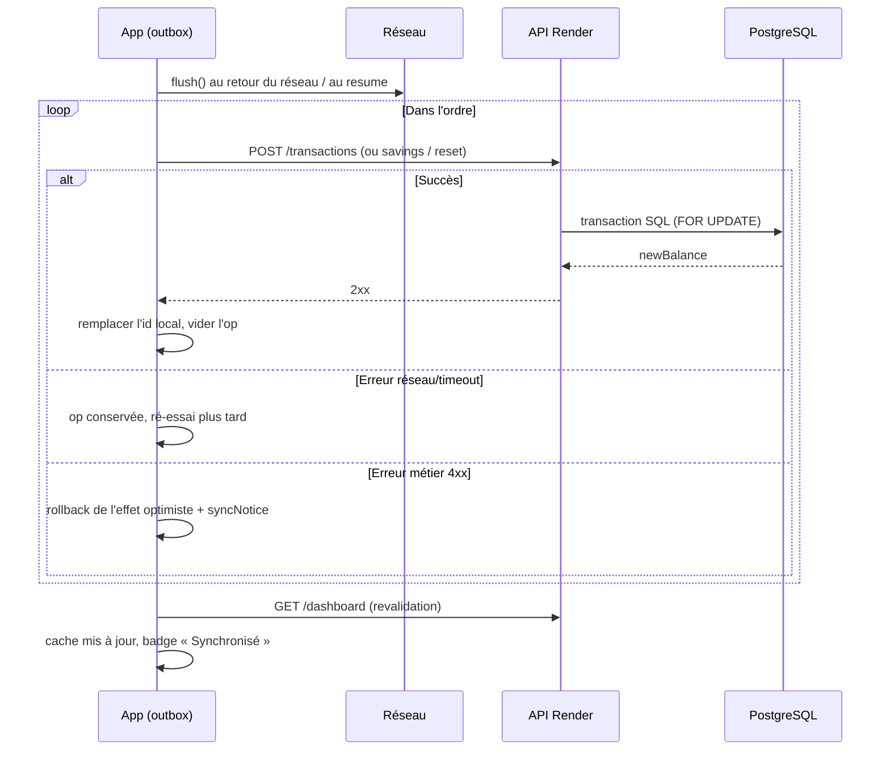

# Hors-ligne et synchronisation

## Sommaire

- [Résumé](#résumé)
- [Persistance locale](#persistance-locale)
- [Écritures optimistes et outbox](#écritures-optimistes-et-outbox)
- [Indicateur de synchronisation](#indicateur-de-synchronisation)
- [Ce qui reste interdit hors-ligne](#ce-qui-reste-interdit-hors-ligne)
- [Séquence de synchronisation](#séquence-de-synchronisation)
- [Règle absolue : une erreur backend n'est jamais « Hors ligne »](#règle-absolue--une-erreur-backend-nest-jamais--hors-ligne-)
- [Conflits et rollback](#conflits-et-rollback)
- [Reset hors-ligne](#reset-hors-ligne)

## Résumé

L'app fonctionne sans réseau : dernières données réelles en cache (SharedPreferences), écritures en file d'attente persistante (`outbox`), rejouées au retour du réseau dans l'ordre. Le badge de synchro distingue « En attente » de « Hors-ligne », et une erreur serveur n'est **jamais** affichée comme « Hors ligne ».

## Persistance locale

SharedPreferences (clés) :

| Clé | Contenu |
|---|---|
| `mybudget.session` | session d'authentification (jetons + utilisateur) |
| `onboarding_seen` | onboarding déjà vu (booléen) |
| `theme_dark`, `budget_alerts` | préférences locales |
| `cache_wallet` | portefeuille (solde, épargne) |
| `cache_dashboard_<id>` | tableau de bord par portefeuille |
| `cache_budgets_<id>` | budgets |
| `cache_txs_<id>` | transactions (complet) |
| `outbox_ops` | écritures en attente |
| `outbox_pending_transactions`, `outbox_deleted_transaction_ids`, `outbox_updated_transactions`, `outbox_hidden_before` | mécanismes de l'outbox |

**Règle d'or** : on n'affiche jamais de donnée inventée — seulement les dernières données réelles mises en cache.

## Écritures optimistes et outbox

`lib/services/outbox.dart` — file d'attente persistante :

- Enqueue dans l'ordre ; échec réseau → l'opération **est conservée** ; erreur métier 4xx → l'opération est **abandonnée** avec rollback de l'effet optimiste local + remontée pour affichage (« syncNotice »).
- Types : `transaction_create|update|delete`, `savings_deposit|withdraw|withdraw_all`, `budget_upsert|delete`, `reset_all`.
- `applyOverlay()` fusionne les opérations en attente avec le cache pour l'affichage immédiat.
- Ajustements optimistes du cache : `_adjustCachedWalletForTx` corrige solde/épargne/dashboard ; les opérations d'épargne ne touchent pas le solde.
- Les ids locaux sont `local_<uuid>`, remplacés par les vrais ids au flush (dédup par ids).

## Indicateur de synchronisation

`SyncController` (Riverpod), basé sur `connectivity_plus` + nombre d'opérations en file :

| État | Libellé | Signification |
|---|---|---|
| `synced` | « Synchronisé » | Rien en attente |
| `pending` | « En attente de synchronisation » | Opérations en file |
| `offline` | « Hors-ligne » | Aucune connectivité détectée |

Debounce 400 ms sur les changements de connectivité. La resynchronisation se déclenche sur : retour au premier plan, `flutter run` initial, et à chaque ouverture d'écran (`refreshAll`).

## Ce qui reste interdit hors-ligne

- **Supprimer son compte** (exige réseau ; l'UI bloque avec un message clair).
- **Restauration d'une période archivée** et **annulation 10 s serveur** (routes dédiées, en ligne uniquement).
- Export CSV (API). L'export **PDF** des transactions est généré localement mais pagine toutes les transactions via l'API (`all=1`) : en pratique, il faut du réseau pour l'historique complet.

## Séquence de synchronisation

## Règle absolue : une erreur backend n'est jamais « Hors ligne »

- Réseau coupé / timeout → état `offline` + opérations conservées. Silencieux.
- Serveur joignable mais en erreur (4xx/5xx) → l'erreur **n'est pas** présentée comme hors-ligne. Une erreur métier (`messageFrom`) s'affiche en français ; les 5xx sont masqués côté prod (« Erreur interne du serveur ») ; les plantages remontent via `POST /client-errors` (fire-and-forget, 30 s max entre deux rapports).
- Un timeout n'affiche jamais « Hors ligne » à tort.

## Conflits et rollback

- Pas de merge : le serveur fait foi (solde recalculé en base). Sur erreur métier au flush, l'effet local optimiste est **annulé** (solde/catégories/compteurs restaurés) et l'utilisateur est prévenu.
- Les suppressions optimistes (`outbox_deleted_transaction_ids`) sont réappliquées tant qu'elles n'ont pas été acquittées par le serveur.

## Reset hors-ligne

- `applyResetLocally()` : `hidden_before = now`, portefeuille à 0 (épargne gardée si non incluse), compteurs budgets à 0, caches purgés.
- **Garde « serveur obsolète »** : si le serveur ne répond pas à `HEAD /wallets/:id/periods` (404), le reset reste en file et ne sera **pas** rejoué ; l'UI bascule en mode « effacement définitif explicite ». C'est une protection anti-destruction, pas un bug.
- Annulation 10 s : `createResetBackup`/`restoreResetBackup` (local, usage unique) ou `PeriodRepository.undo` (serveur, en ligne).
