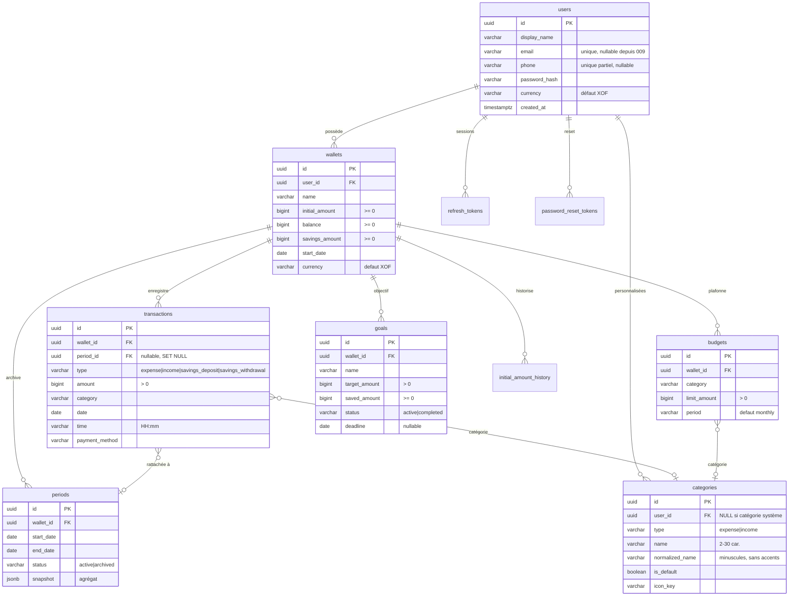

# Modèle de données

## Sommaire

- [Résumé](#résumé)
- [Diagramme entité-association (erDiagram)](#diagramme-entité-association-erdiagram)
- [Tables (schéma PostgreSQL réel)](#tables-schéma-postgresql-réel)
- [Index](#index)
- [Contraintes et triggers](#contraintes-et-triggers)
- [Documents d'agrégat (snapshots)](#documents-dagrégat-snapshots)
- [Règles de sécurité côté données](#règles-de-sécurité-côté-données)
- [Firestore ?](#firestore-)

## Résumé

MyBudget stocke **tout en PostgreSQL 16** : utilisateurs, portefeuilles, transactions, budgets, périodes, objectifs, catégories. Pas de Firestore. Montants en `BIGINT` (entiers, **référence XOF** — conversion à l'affichage uniquement, la préférence d'affichage de l'utilisateur n'est jamais écrite en base), dates `DATE` (`YYYY-MM-DD`), horodatages `TIMESTAMPTZ` (UTC). Le schéma est créé par les migrations `backend/src/database/migrations/` (001→010 ; **004 absent**, 003 enchaîne sur 005). La migration 010 ajoute les catégories personnalisées (`categories`), les liens `category_id` et la colonne `users.data_epoch` (cf. `src/database/backfill_categories.js` pour le rattachement des données historiques).

## Diagramme entité-association (erDiagram)



## Tables (schéma PostgreSQL réel)

### users — migrations 001, 009, 010
| Champ | Type | Règle |
|---|---|---|
| `id` | UUID PK | `gen_random_uuid()` |
| `display_name` | VARCHAR(100) | NOT NULL, trimé 2–100 côté serveur |
| `email` | VARCHAR(255) | NOT NULL en 001, **nullable depuis 009** ; UNIQUE ; minuscules |
| `phone` | VARCHAR(20) | nullable ; regex `^\+[1-9]\d{7,14}$` ; index **unique partiel** `users_phone_unique` |
| `password_hash` | VARCHAR(255) | bcrypt |
| `photo_url` | VARCHAR(500) | nullable |
| `currency` | VARCHAR(8) | NOT NULL, défaut `XOF` |
| `data_epoch` | INTEGER | NOT NULL, défaut 0 ; **incrémenté à chaque réinitialisation complète** (010) |
| `created_at` / `updated_at` | TIMESTAMPTZ | défaut `now()` |

### password_reset_tokens — migration 001
`id` UUID PK · `user_id` UUID FK → users ON DELETE CASCADE · `token_hash` VARCHAR(255) UNIQUE (SHA-256, à usage unique) · `expires_at` TIMESTAMPTZ (1 h) · `used_at` TIMESTAMPTZ nullable · `created_at` TIMESTAMPTZ.

### refresh_tokens — migration 001
`id` UUID PK · `user_id` FK CASCADE · `token_hash` VARCHAR(255) UNIQUE (SHA-256) · `expires_at` (30 j) · `revoked_at` nullable · rotation à chaque refresh.

### wallets — migrations 002, 006, 005, 007
| Champ | Type | Règle |
|---|---|---|
| `id` | UUID PK | |
| `user_id` | UUID FK → users | CASCADE |
| `name` | VARCHAR(100) | NOT NULL |
| `initial_amount` | BIGINT | NOT NULL, ≥ 0 |
| `balance` | BIGINT | NOT NULL, CHECK ≥ 0 |
| `savings_amount` | BIGINT | NOT NULL, défaut 0, CHECK ≥ 0 (006) |
| `start_date` | DATE | NOT NULL, défaut `CURRENT_DATE` |
| `currency` | VARCHAR(8) | NOT NULL, défaut `XOF` |
| `created_at` / `updated_at` | TIMESTAMPTZ | |

### initial_amount_history — migration 002
`id` · `wallet_id` FK CASCADE · `old_value`/`new_value` BIGINT NOT NULL · `changed_at` TIMESTAMPTZ. 100 derniers par wallet (`GET /wallets/:id/initial-amount/history`).

### transactions — migrations 003, 007, 008, 010
| Champ | Type | Règle |
|---|---|---|
| `id` | UUID PK | |
| `wallet_id` | UUID FK | CASCADE |
| `period_id` | UUID FK → periods | nullable, ON DELETE SET NULL (007) |
| `type` | VARCHAR(20) | CHECK `expense` · `income` · `savings_deposit` · `savings_withdrawal` |
| `amount` | BIGINT | NOT NULL, CHECK > 0 |
| `category` | VARCHAR(50) NOT NULL | texte dénormalisé (nom affiché, recherche, CSV) |
| `category_id` | UUID FK → categories | nullable, ON DELETE SET NULL (010) |
| `description` | VARCHAR(200) | optionnel |
| `date` | DATE NOT NULL | `YYYY-MM-DD` |
| `time` | VARCHAR(5) NOT NULL | `HH:mm` |
| `payment_method` | VARCHAR(30) | `Espèces` · `Mobile Money` · `Carte` · `Virement` |
| `created_at` / `updated_at` | TIMESTAMPTZ | |

### categories — migration 010
| Champ | Type | Règle |
|---|---|---|
| `id` | UUID PK | client peut fournir l'id (idempotence hors-ligne) |
| `user_id` | UUID FK → users | nullable = catégorie système (par défaut) ; CASCADE sur suppression du compte |
| `type` | VARCHAR(10) | CHECK `expense` · `income` |
| `name` | VARCHAR(30) NOT NULL | lettres/chiffres/espaces/apostrophes/tirets |
| `normalized_name` | VARCHAR(30) NOT NULL | minuscules, sans accents, espaces normalisés |
| `is_default` | BOOLEAN NOT NULL | défaut système ≠ personnalisée |
| `icon_key` | VARCHAR(30) NOT NULL | icône affichée (`label` par défaut) |

Unicité : `(COALESCE(user_id, '00000000-…-000000000000'::uuid), type, normalized_name)` — empêche doublons concurrents, casse/accents insensibles, défauts inclus.

### budgets — migrations 003, 010
`id` UUID PK · `user_id` FK · `wallet_id` FK · `category` VARCHAR(50) · `category_id` UUID FK → categories (010, ON DELETE SET NULL) · `limit_amount` BIGINT CHECK > 0 · `period` VARCHAR(20) défaut `monthly` · **UNIQUE `(wallet_id, category)`** · timestamps.

### periods — migration 007
`id` UUID PK · `user_id` FK · `wallet_id` FK · `start_date`/`end_date` DATE NOT NULL, CHECK `end_date >= start_date` · `status` VARCHAR(10) CHECK `active` | `archived`, défaut `active` · `snapshot` JSONB · `created_at` · `closed_at` TIMESTAMPTZ. **Index unique partiel** `uq_periods_one_active` : une seule période `active` par wallet.

### goals — migration 007
`id` UUID PK · `user_id` FK · `wallet_id` FK · `name` VARCHAR(100) · `target_amount` BIGINT CHECK > 0 · `saved_amount` BIGINT NOT NULL défaut 0, CHECK ≥ 0 et ≤ `target_amount` · `deadline` DATE nullable · `status` VARCHAR(12) CHECK `active` | `completed`, défaut `active`.

## Index

| Table | Index |
|---|---|
| users | `idx_users_email`, `users_phone_unique` (unique partiel, `WHERE phone IS NOT NULL`) |
| password_reset_tokens | `idx_password_reset_user` |
| refresh_tokens | `idx_refresh_tokens_user` |
| wallets | `idx_wallets_user` |
| initial_amount_history | `idx_iah_wallet` |
| transactions | `idx_tx_wallet_date (wallet_id, date DESC, created_at DESC)`, `idx_tx_wallet_type`, `idx_tx_wallet_category`, `idx_tx_wallet_period`, `idx_tx_wallet_savings` (partiel `WHERE type LIKE 'savings_%'`), `idx_tx_category_id` (010) |
| budgets | unique implicite `(wallet_id, category)`, `idx_budgets_category_id` (010) |
| categories | `categories_owner_type_name` (unique, 010) |
| periods | `idx_periods_wallet`, `uq_periods_one_active` (unique partiel) |
| goals | `idx_goals_wallet` |

## Contraintes et triggers

- **`clamp_wallet_savings`** (006) : trigger `BEFORE UPDATE` sur `wallets` — `savings_amount` ne peut pas dépasser `balance` (`GREATEST(0, balance)` appliqué sinon).
- `CHECK` partout : `balance ≥ 0`, `savings_amount ≥ 0`, `amount > 0`, `limit_amount > 0`, `target_amount > 0`, `saved_amount ≤ target_amount`.
- Suppression de compte (`DELETE /auth/me`) : cascade complète (wallets → transactions, budgets, periods, goals, tokens).

## Documents d'agrégat (snapshots)

`periods.snapshot` (JSONB) fige l'état d'une période au moment de la clôture :

```json
{
  "wallet": { "balance": 155000, "savings_amount": 20000, "initial_amount": 100000 },
  "totals": { "totalExpenses": 45000, "totalIncomes": 100000, "transactionsCount": 37, "saved": 20000 },
  "closedAt": "2026-11-30T23:59:59Z",
  "previousPeriodId": "…",
  "previousWallet": { "...": "état avant ouverture de la nouvelle période" },
  "previousGoalsSaved": 15000
}
```
*Exemple illustratif — les vrais snapshots dépendent du code.*

C'est le support de : l'annulation 10 s (`undo`), la restauration d'une période archivée (`restore`), et l'affichage de l'historique mensuel.

## Règles de sécurité côté données

1. Aucune requête métier ne filtre sans `user_id` (issu du JWT) : isolation stricte inter-utilisateurs.
2. Comparaisons d'identifiants UUID par regex `^[0-9a-f-]{36}$` avant requête.
3. Montants entiers : la base rejette les flottants (`BIGINT`) et valeurs ≤ 0 (`CHECK`).
4. Intégrité concurrente : verrous `FOR UPDATE` + transactions SQL.

## Firestore ?

`docs/firestore.rules` est un **artefact obsolète** du prototype abandonné (novembre 2026). Il ne correspond à aucune base active et peut être ignoré (ou supprimé) — voir `docs/securite-et-confidentialite.md`.
