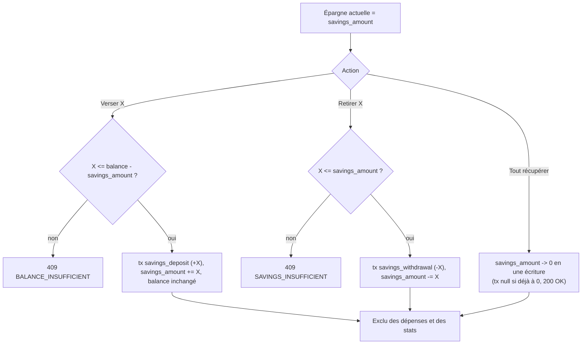
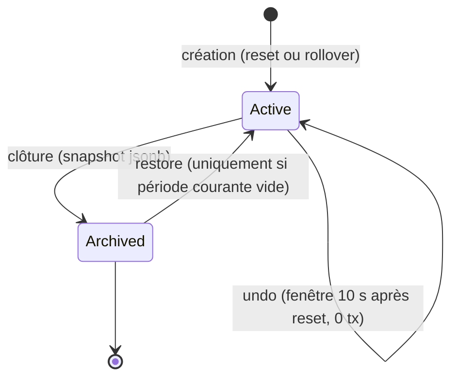

# Règles métier

## Sommaire

- [Résumé](#résumé)
- [Montants : entiers FCFA partout](#montants--entiers-fcfa-partout)
- [Dates : stockage UTC, affichage local](#dates--stockage-utc-affichage-local)
- [Solde et « Reste »](#solde-et--reste-)
- [Portefeuille](#portefeuille)
- [Épargne](#épargne)
- [Budgets et alertes](#budgets-et-alertes)
- [Périodes mensuelles](#périodes-mensuelles)
- [Catégories personnalisées](#catégories-personnalisées)
- [Objectifs d'épargne (goals)](#objectifs-dépargne-goals)
- [Catégories par défaut](#catégories-par-défaut)
- [Exemples chiffrés (fictifs)](#exemples-chiffrés-fictifs)

## Résumé

Le solde est recalculé côté serveur à chaque écriture, dans une transaction avec verrou ; le « Reste » affiché = solde − épargne. L'épargne est une réserve dans le même portefeuille et n'entre jamais dans les dépenses/statistiques. Les budgets alertent à 50 % / 80 % / 100 % et notifient en local à 80 % et 100 %. La réinitialisation est atomique et définitive (voir [Réinitialisation complète](#réinitialisation-complète-du-compte-comme-neuf)).

## Montants : entiers FCFA partout

- Type unique : **entier** (`BIGINT` SQL, `int` Dart). Aucune décimale nulle part. `isValidAmount`/`parseAmount` (backend), `formatXof` (mobile : « 155 000 FCFA »).
- `Number.isSafeInteger` exigé ; un montant ≤ 0 est rejeté (400).
- Devise : `XOF` (FCFA), non modifiable dans l'UI (« Devise — FCFA (XOF) »).

## Dates : stockage UTC, affichage local

- Échange/stockage : `date` en `YYYY-MM-DD` (jour civil), `created_at` en `TIMESTAMPTZ` (UTC).
- Affichage : **JJ/MM/AAAA** (heure locale Bénin, UTC+1), listes « JJ/MM/AAAA · HH:mm », mois « novembre 2026 ». UTC+1 est codé en dur côté backend (`LOCAL_OFFSET_MS`) pour les bornes de périodes.
- Bornes statistiques : minuit→minuit local ; la semaine = 7 jours glissants locaux ; le mois précédent sert de comparaison pour `period=month`.

## Solde et « Reste »

Formule : `balance = initial_amount + Σ(revenus) − Σ(dépenses)` de **la période active** (les dépenses/revenus d'épargne ne comptent pas).

- Écriture atomique : `BEGIN; SELECT … FOR UPDATE; INSERT/UPDATE; COMMIT`. En cas de concurrence, l'une des deux écritures est refusée (409 `BALANCE_INSUFFICIENT`).
- Dépense plafond : `amount ≤ balance − savings_amount`. Au-delà → 409 `BALANCE_INSUFFICIENT`.
- **« Reste » = `balance − savings_amount`** (jamais négatif : clamp à 0 côté client). C'est le montant dépensable sans toucher à l'épargne.
- Le « solde » affiché sur l'accueil reste `balance` ; le Reste est la métrique actionnable.
- `recalculate` : recalcule `balance` depuis `initial_amount` + mouvements de la période active (idempotent, transactionnel).

## Portefeuille

- Un utilisateur peut avoir plusieurs portefeuilles (`GET /wallets` retourne la liste ; l'app mobile utilise le premier).
- Création : `POST /wallets { name, initialAmount }` — `initialAmount ≥ 0` entier.
- Montant initial modifiable : `PATCH /wallets/:id/initial-amount` — historisé dans `initial_amount_history` (100 entrées) ; refusé (409 `SAVINGS_LOCKED`) si le nouveau solde serait inférieur à la somme des `saved_amount` des objectifs.
- **Montant initial historisé** : chaque changement est archivé, jamais écrasé en silence.

## Épargne

Réserve interne au portefeuille, pas un compte séparé.

- Les mouvements d'épargne créent une transaction de type `savings_deposit`/`savings_withdrawal`, catégorie « Épargne ».
- **L'épargne n'entre jamais dans les dépenses, revenus ou budgets** (stats et dashboard excluent `savings_*`).
- `balance` ne bouge pas sur versement/retrait : seule la réserve change ; le **Reste** diminue au versement, remonte au retrait.
- Trigger `clamp_wallet_savings` : `savings_amount` ne peut pas excéder `balance`.
- Client : `WalletController.setSavings(n)` valide `0 ≤ n ≤ balance`, poste **un seul appel** (dépôt/retrait du delta). Hors-ligne : l'opération part dans l'outbox (`enqueueSavings`).
- Côté API mobile : `POST /wallets/:id/savings/deposit|withdraw|withdraw-all`.

## Budgets et alertes

- Un budget par **(portefeuille, catégorie)** (contrainte UNIQUE, 409 `BUDGET_EXISTS`) ; une catégorie personnalisée peut avoir un budget (résolution par `categoryId` si la catégorie est fournie).
- `limitAmount` entier > 0, période `monthly`.
- `spent` = Σ dépenses de la catégorie sur la période active (ou `[dateFrom;dateTo]`).
- **Niveaux d'alerte : 50 % / 80 % / 100 %** (pas 80/100 seulement) :
  - `spent/limit ≥ 1` → 100 ; `≥ 0.8` → 80 ; `≥ 0.5` → 50 ; sinon 0.
- `remaining = max(0, limit − spent)`, `percent` arrondi, `alertLevel` calculé par le backend à chaque lecture.
- **Notifications locales** (Android 13+) : quand une opération fait atteindre **80 % puis 100 %** d'un budget, l'app affiche une notification locale — une seule fois par seuil et par période (mois courant). L'interrupteur « Alertes de budget » du profil est vérifié à chaque évaluation ; éteint, aucune alerte n'est jamais émise. L'activation demande la permission `POST_NOTIFICATIONS` ; un refus laisse l'interrupteur éteint avec un message clair.

## Périodes mensuelles

Cycle de vie (côté API uniquement — l'app n'appelle plus ces routes) :

> **Note** : depuis novembre 2026, l'app ne remet plus un mois à zéro « avec archivage » ; la réinitialisation est globale et définitive (voir section suivante). Les routes `/wallets/:id/period*` restent disponibles sur l'API mais ne sont plus appelées par l'app. L'annulation 10 s et la restauration restent fonctionnelles via l'API et les tests e2e.

- **Période active** : `status='active'`, bornes `start_date`→fin de mois (`end_date`). Une seule active par wallet (index unique partiel).
- **Période archivée** : snapshot JSONB dans `periods.snapshot` (solde, épargne, totaux, goals) — historique conservé, restauration possible si la période courante est vide (409 `RESTORE_BLOCKED` sinon).
- **Annulation 10 s** : `POST /wallets/:id/period/:periodId/undo` — 10000 ms, zéro transaction sur la nouvelle période, goals inchangés ; sinon 409 (`UNDO_EXPIRED` / `UNDO_UNAVAILABLE`).
- **Historique** : `GET /wallets/:id/periods` liste les archives ; transactions filtrables avec `all=1`.
- Noms de mois affichés : « novembre 2026 » (locale fr_FR).

## Catégories personnalisées

- Table `categories` : `is_default=true` pour les défauts (système, `user_id` NULL), sinon personnalisée (propriétaire `user_id`).
- **Règles de nommage** : trim, 2 à 30 caractères ; lettres/chiffres/espaces/apostrophes/tirets uniquement (regex serveur) ; espaces multiples réduits.
- **Unicité par (propriétaire, type, nom normalisé)** : doublon = fusion automatique côté serveur (409 `CATEGORY_EXISTS` avec la catégorie existante — le client la sélectionne et affiche « Cette catégorie existe déjà, elle est sélectionnée ») ; sensibilité casse/accents ignorée, y compris contre les catégories par défaut.
- **Maximum 30 catégories personnalisées par type** (dépense ou revenu) ; au-delà, erreur 400.
- **Ordre d'affichage** : catégories par défaut (ordre produit) → personnalisées (par nom) → « Autres » en dernier, séparément pour dépenses et revenus.
- **Création** : dans le sélecteur de catégorie, « Autres » ouvre un champ « Nom de la catégorie » avec un bouton Valider. Vide → l'opération reste en « Autres ». Hors-ligne : création en file d'attente avec id UUID client ; conflit au retour réseau = fusion sur l'existante (remapping automatique des transactions créées hors-ligne).
- **Modification / renommage** : Profil → « Mes catégories » ; le renommage se propage au texte dénormalisé des opérations et budgets liés (même transaction SQL).
- **Suppression** : les opérations liées passent en « Autres » (jamais perdues) ; les budgets liés sont supprimés **avec confirmation** (409 `CATEGORY_HAS_BUDGET` d'abord, puis `confirmBudgets=1`).
- **Recherche** : le nom est cherchable (insensible accents), comme les défauts. **Export CSV** : le texte est réécrit lors des renommages. **Stats** : réparties par catégorie comme les défauts. **Budgets** : une catégorie personnalisée accepte un budget (`categoryId` prioritaire sur le nom).

## Réinitialisation complète du compte ("comme neuf")

- Route : `POST /api/v1/me/reset` (JWT) — **une seule transaction PostgreSQL** : tout ou rien.
- Supprimé **définitivement** : portefeuilles, opérations, budgets, épargne (colonnes), objectifs, périodes et archives, catégories personnalisées, historique du montant initial. Les catégories par défaut sont conservées (elles n'appartiennent à personne).
- Conservés : compte (téléphone, e-mail, mot de passe, sessions), `data_epoch` **incrémenté** ; préférences de l'appareil (thème, langue, interrupteurs).
- **Autres appareils** : au prochain `GET /auth/me`, si `dataEpoch` a changé, le cache local et la file d'attente sont effacés et l'app se recharge — sans renvoyer d'anciennes opérations (elles ne ressuscitent pas de données).
- **Client** : après succès, purge complète du cache local + file d'attente, redirection vers la création du premier portefeuille (comme juste après l'inscription), jamais vers les 3 écrans d'introduction.
- **Hors-ligne** : la réinitialisation est refusée avec « Connexion requise pour réinitialiser ».
- **Anti-erreur** : écran avec liste de ce qui sera supprimé + export CSV possible avant + confirmation forte (taper `REINITIALISER`), distincte de « Supprimer mon compte ».

## Objectifs d'épargne (goals)

- `POST /wallets/:id/goals { name, targetAmount, deadline? }` — contribution (`contribute`) = déplace du disponible vers l'épargne ; statut auto `completed` quand `saved ≥ target`.
- Suppression interdite si `saved_amount > 0` (409 `GOAL_HAS_SAVINGS`).
- Les goals partagent le même pot d'épargne que l'épargne « libre » ; `updateInitialAmount` est refusé si le nouveau solde < Σ(goals.saved_amount).
- Une mise de côté via un objectif est donc aussi hors des dépenses.

## Catégories par défaut

- Dépenses (11) : Alimentation, Transport, Logement, Santé, Études, Communication, Loisirs, Shopping, Abonnements, Famille, Autres.
- Revenus (5) : Salaire, Business, Cadeau, Bourse, Autres.
- Épargne : « Épargne » (imposé par l'API).
- Modes de paiement : Espèces, Mobile Money, Carte, Virement (défaut « Espèces » pour une dépense).

## Exemples chiffrés (fictifs)

> Exemple fictif, uniquement pour illustrer.

- Portefeuille : initial 100 000 FCFA. Revenu 150 000 → solde 250 000.
- Épargne versée 50 000 → solde toujours 250 000, Reste = 200 000, épargne 50 000.
- Dépense 30 000 → solde 220 000, Reste 170 000. Dépense > 170 000 → refusée (409).
- Budget Alimentation 80 000 : dépenses du mois 40 000 (50 %), 64 000 (80 %), 80 000 (100 %) → alertes jaunes puis rouges dans l'onglet Budgets.
