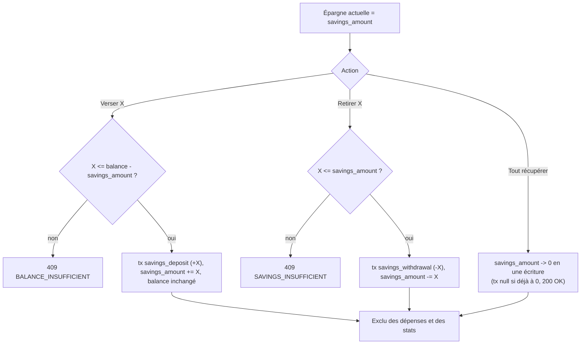
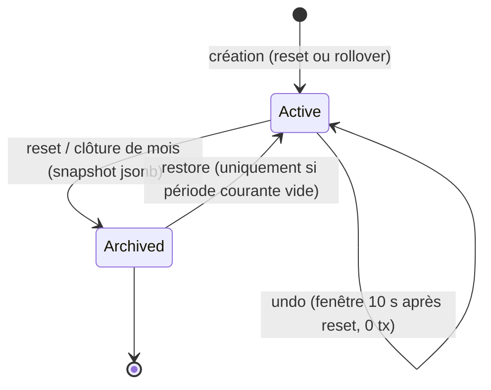

# Règles métier

## Sommaire

- [Résumé](#résumé)
- [Montants : entiers FCFA partout](#montants--entiers-fcfa-partout)
- [Dates : stockage UTC, affichage local](#dates--stockage-utc-affichage-local)
- [Solde et « Reste »](#solde-et--reste-)
- [Portefeuille](#portefeuille)
- [Épargne](#épargne)
- [Budgets et alertes](#budgets-et-alertes)
- [Périodes mensuelles et réinitialisation](#périodes-mensuelles-et-réinitialisation)
- [Objectifs d'épargne (goals)](#objectifs-dépargne-goals)
- [Catégories](#catégories)
- [Exemples chiffrés (fictifs)](#exemples-chiffrés-fictifs)

## Résumé

Le solde est recalculé côté serveur à chaque écriture, dans une transaction avec verrou ; le « Reste » affiché = solde − épargne. L'épargne est une réserve dans le même portefeuille et n'entre jamais dans les dépenses/statistiques. Les budgets alertent à 50 %, 80 %, 100 % ; les périodes sont mensuelles, archivables et réinitialisables (annulation 10 s).

## Montants : entiers FCFA partout

- Type unique : **entier** (`BIGINT` SQL, `int` Dart). Aucune décimale nulle part. `isValidAmount`/`parseAmount` (backend), `formatXof` (mobile : « 155 000 FCFA »).
- `Number.isSafeInteger` exigé ; un montant ≤ 0 est rejeté (400).
- Devise : `XOF` (FCFA), non modifiable dans l'UI (« Devise — FCFA (XOF) »).

## Dates : stockage UTC, affichage local

- Échange/stockage : `date` en `YYYY-MM-DD` (jour civil), `created_at` en `TIMESTAMPTZ` (UTC).
- Affichage : **JJ/MM/AAAA** (heure locale Bénin, UTC+1), listes « JJ/MM/AAAA · HH:mm », mois « novembre 2026 ». UTC+1 est codé en dur côté backend (`LOCAL_OFFSET_MS`) pour les bornes de périodes.
- Bornes statistiques : minuit→minuit local ; la semaine = 7 jours glissants locaux ; le mois précédent sert de comparaison pour `period=month`.

## Solde et « Reste »

Formule : `balance = initial_amount + Σ(revenus) − Σ(dépenses)` de **la période active** (les dépenses/revenus d'épargne ne comptent pas).

- Écriture atomique : `BEGIN; SELECT … FOR UPDATE; INSERT/UPDATE; COMMIT`. En cas de concurrence, l'une des deux écritures est refusée (409 `BALANCE_INSUFFICIENT`).
- Dépense plafond : `amount ≤ balance − savings_amount`. Au-delà → 409 `BALANCE_INSUFFICIENT`.
- **« Reste » = `balance − savings_amount`** (jamais négatif : clamp à 0 côté client). C'est le montant dépensable sans toucher à l'épargne.
- Le « solde » affiché sur l'accueil reste `balance` ; le Reste est la métrique actionnable.
- `recalculate` : recalcule `balance` depuis `initial_amount` + mouvements de la période active (idempotent, transactionnel).

## Portefeuille

- Un utilisateur peut avoir plusieurs portefeuilles (`GET /wallets` retourne la liste ; l'app mobile utilise le premier).
- Création : `POST /wallets { name, initialAmount }` — `initialAmount ≥ 0` entier.
- Montant initial modifiable : `PATCH /wallets/:id/initial-amount` — historisé dans `initial_amount_history` (100 entrées) ; refusé (409 `SAVINGS_LOCKED`) si le nouveau solde serait inférieur à la somme des `saved_amount` des objectifs.
- **Montant initial historisé** : chaque changement est archivé, jamais écrasé en silence.

## Épargne

Réserve interne au portefeuille, pas un compte séparé.

- Les mouvements d'épargne créent une transaction de type `savings_deposit`/`savings_withdrawal`, catégorie « Épargne ».
- **L'épargne n'entre jamais dans les dépenses, revenus ou budgets** (stats et dashboard excluent `savings_*`).
- `balance` ne bouge pas sur versement/retrait : seule la réserve change ; le **Reste** diminue au versement, remonte au retrait.
- Trigger `clamp_wallet_savings` : `savings_amount` ne peut pas excéder `balance`.
- Client : `WalletController.setSavings(n)` valide `0 ≤ n ≤ balance`, poste **un seul appel** (dépôt/retrait du delta). Hors-ligne : l'opération part dans l'outbox (`enqueueSavings`).
- Côté API mobile : `POST /wallets/:id/savings/deposit|withdraw|withdraw-all`.

## Budgets et alertes

- Un budget par **(portefeuille, catégorie)** (contrainte UNIQUE, 409 `BUDGET_EXISTS`).
- `limitAmount` entier > 0, période `monthly`.
- `spent` = Σ dépenses de la catégorie sur la période active (ou `[dateFrom;dateTo]`).
- **Niveaux d'alerte : 50 % / 80 % / 100 %** (pas 80/100 seulement) :
  - `spent/limit ≥ 1` → 100 ; `≥ 0.8` → 80 ; `≥ 0.5` → 50 ; sinon 0.
- `remaining = max(0, limit − spent)`, `percent` arrondi, `alertLevel` calculé par le backend à chaque lecture.
- L'interrupteur « Alertes de budget » du profil est un ** booléen local** (`budget_alerts`) : il n'envoie aucune notification. Voir `docs/detection-notifications.md`.

## Périodes mensuelles et réinitialisation

Cycle de vie :

- **Période active** : `status='active'`, bornes `start_date`→fin de mois (`end_date`). Une seule active par wallet (index unique partiel).
- **Réinitialisation** (`POST /wallets/:id/reset`, body `{ includeSavings? }`) : archive la période active (snapshot), crée la nouvelle (aujourd'hui → fin du mois), puis :
  - `includeSavings=false` (défaut) : `balance = savings_amount` conservée, `initial_amount = keptSavings` ;
  - `includeSavings=true` : tout repart à 0 (`balance=savings=0`).
- **Annulation 10 s** : `POST /wallets/:id/period/:periodId/undo` (periodId = la **nouvelle** période). Conditions : `UNDO_WINDOW_MS=10000`, zéro transaction sur la nouvelle période, goals inchangés ; sinon 409 (`UNDO_EXPIRED` / `UNDO_UNAVAILABLE`).
- **Restauration** : `POST /wallets/:id/periods/:periodId/restore` — la période courante doit être vide (0 transaction) et les goals inchangés, sinon 409 `RESTORE_BLOCKED` ; la cible archivée repasse active, le wallet est restauré depuis le snapshot.
- Historique : `GET /wallets/:id/periods` liste les archives ; transactions filtrables avec `all=1`.
- **Fin de mois** : les modèles côté client exposent `needsNewPeriod`/`daysLeft`, mais **aucun écran ne propose encore le rollover automatique** — côté app, la réinitialisation est manuelle (profil → « Réinitialiser tout à 0 »). *À confirmer* : comportement côté serveur si le mois change sans action (aucune tâche planifiée connue).
- Noms de mois affichés : « novembre 2026 » (locale fr_FR).

## Objectifs d'épargne (goals)

- `POST /wallets/:id/goals { name, targetAmount, deadline? }` — contribution (`contribute`) = déplace du disponible vers l'épargne ; statut auto `completed` quand `saved ≥ target`.
- Suppression interdite si `saved_amount > 0` (409 `GOAL_HAS_SAVINGS`).
- Les goals partagent le même pot d'épargne que l'épargne « libre » ; `updateInitialAmount` est refusé si le nouveau solde < Σ(goals.saved_amount).
- Une mise de côté via un objectif est donc aussi hors des dépenses.

## Catégories

- Dépenses (11) : Alimentation, Transport, Logement, Santé, Études, Communication, Loisirs, Shopping, Abonnements, Famille, Autres.
- Revenus (5) : Salaire, Business, Cadeau, Bourse, Autres.
- Épargne : « Épargne » (imposé par l'API).
- Modes de paiement : Espèces, Mobile Money, Carte, Virement (défaut « Espèces » pour une dépense).

## Exemples chiffrés (fictifs)

> Exemple fictif, uniquement pour illustrer.

- Portefeuille : initial 100 000 FCFA. Revenu 150 000 → solde 250 000.
- Épargne versée 50 000 → solde toujours 250 000, Reste = 200 000, épargne 50 000.
- Dépense 30 000 → solde 220 000, Reste 170 000. Dépense > 170 000 → refusée (409).
- Budget Alimentation 80 000 : dépenses du mois 40 000 (50 %), 64 000 (80 %), 80 000 (100 %) → alertes jaunes puis rouges dans l'onglet Budgets.
